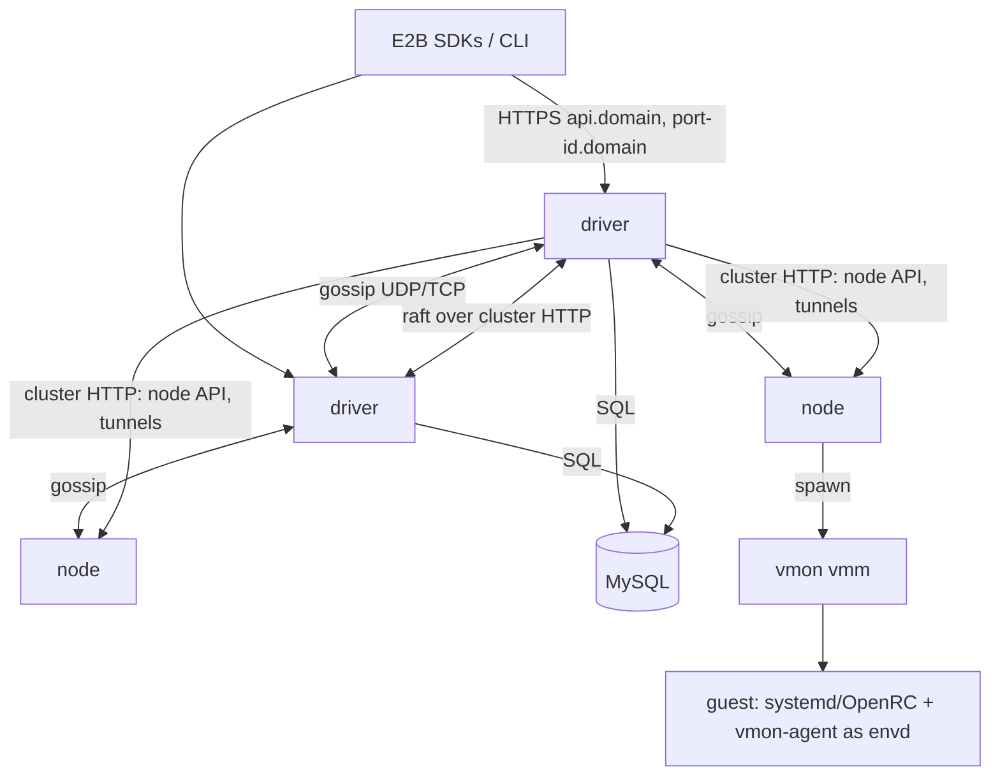
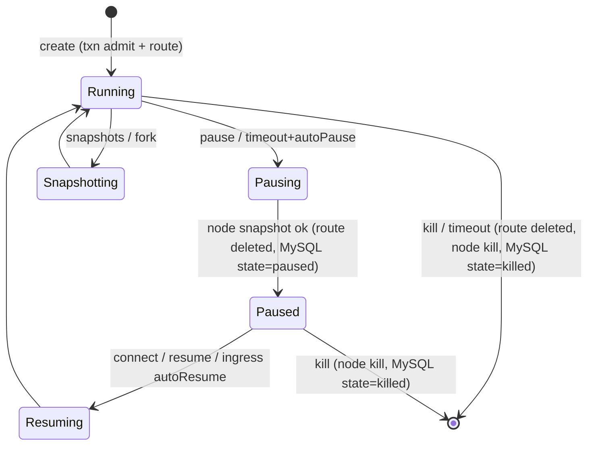

# Vibemon architecture

Normative design for the E2B-compatible vibemon platform. When code and this
document disagree, one of them is a bug. E2B wire-level facts referenced here
live in `spec/e2b/` (vendored upstream specs) and `docs/src/reference/e2b-compat.md`
(endpoint-by-endpoint compatibility matrix).

## 1. Shape

One binary, `vmon`, three entry points:

| Command | Purpose |
|---|---|
| `vmon vmm …` | Per-VM monitor (the `vmm` crate). Spawned by the node role; never by users. |
| `vmon serve --role node,driver …` | Long-running server. A process runs the **node** role (hosts microVMs), the **driver** role (E2B API, scheduling, ingress), or both. |
| `vmon admin …` | Operator tooling against MySQL (teams, users, API keys, limits, system teams). The admin token is `vmon serve --admin-token`. |



- **Gossip memberlist** (`cluster::gossip`): every process. Membership,
  liveness, and per-member metadata (roles, addresses, capacity). This is how
  nodes and drivers find each other.
- **Raft KV** (`cluster::kv`): drivers are raft voters; node-only processes are
  KV clients that forward to a driver. Holds hot, cluster-coordinated state
  (live sandbox catalog, admission counters, locks, artifact locations).
- **MySQL** (`driver::store`): durable system of record (teams, keys,
  templates, builds, sandboxes, snapshots, volumes, secrets, events).
- **Node** (`node` crate): runs VMs, builds templates, stores artifacts and
  volumes, exposes the node API and guest tunnels on the cluster listener.
- **Driver** (`driver` crate): E2B REST API, auth, placement, lifecycle
  supervision, build supervision, ingress proxy for sandbox traffic.
- **Guest agent** (`agent` crate, `vmon-agent`): installed as `/usr/bin/envd`
  and run as the `envd` service under the template's systemd/OpenRC (PID 1
  only in build VMs and in templates of unknown distributions, §10). Serves
  the GC4 control channel on the `vmon.gc4` virtio-console port and an E2B
  **envd**-compatible HTTP/Connect server on guest TCP `49983`.

Monolithic = one `vmon serve --role node,driver`. Distributed = any mix; all
processes discover each other through gossip seeds (`--join`).

## 2. Workspace

| Path | Crate | Owns |
|---|---|---|
| `vmm/` | `vmm` | Core VMM (KVM/HVF/WHP). Unchanged except targeted fixes. |
| `agent/` | `vmon-agent` | Guest init + GC4 control + envd. Also exports `proto` (GC4 codec) for host use. |
| `cloud/` | `vmon-cloud` | Object auth helpers used by `vmm` remote rootfs. |
| `cluster/` | `vmon-cluster` | `gossip`, `kv` (openraft), `meta` (typed member metadata), `Cluster` facade, cluster HTTP auth helpers. |
| `node/` | `vmon-node` | VM runtime, GC4 host client, tunnels, networking, egress proxy, images/builds, artifacts, volumes, metrics/logs, node API server (`node::api`) and client (`node::client`). |
| `driver/` | `vmon-driver` | E2B API (`driver::api`), MySQL store (`driver::store`), auth, scheduler, lifecycle, builds, ingress proxy, admin commands. Depends on `vmon-node` for `node::api` DTOs and `node::client`. |
| `src/` | `vmon` (bin) | Argument parsing, config, role wiring, `vmon admin`. |
| `e2e/` | — | Real-SDK end-to-end suites (Python `e2b`, JS `e2b`) driven against a live `vmon serve`. |
| `templates/` | — | Template definitions we ship (`base`, `code-interpreter-v1`, `desktop`, `mcp-gateway`, and the `ubuntu-systemd` reference template) as E2B v2 build scripts. |
| `kernel/` | — | vmon guest kernel: cloud-hypervisor `ch_defconfig` + fragments (netfilter/nft, IPv6, bridge, cgroup v2, BPF/BTF, NFS, …) and the reproducible `build.sh` behind `just kernel` and the release `kernel` job. |
| `spec/e2b/` | — | Vendored upstream specs (OpenAPI, envd protos). |

Runtime: tokio (multi-thread) in `serve`; axum 0.8 / hyper 1 for HTTP;
reqwest (rustls) for outbound HTTP; sqlx 0.9 (MySQL); openraft 0.9. The `vmm`
crate stays synchronous.

## 3. Listeners and addressing

| Flag | Default | Protocol | Served by |
|---|---|---|---|
| `--listen` | `0.0.0.0:3000` | public HTTP/1.1 + h2c | driver: E2B API + sandbox ingress |
| `--tls-listen` + `--tls-cert/--tls-key` | off | public HTTPS (h2/http1.1 ALPN) | same router as `--listen` |
| `--cluster-listen` / `--cluster-advertise` | `0.0.0.0:7947` / derived | internal HTTP | `/cluster/v1/*` (raft, kv), `/node/v1/*` (node API, tunnels) |
| `--gossip-listen` / `--gossip-advertise` | `0.0.0.0:7946` / derived | UDP (probes) + TCP (push-pull) | gossip |

Cluster HTTP and gossip are authenticated with the shared `--cluster-secret`
(`VMON_CLUSTER_SECRET`): HTTP uses `Authorization: Bearer <secret>`
(constant-time compare); gossip packets carry an HMAC-SHA256 tag keyed by
`HKDF(secret, "vmon-gossip")`. Unauthenticated packets are dropped.

Every TCP socket these listeners accept or the process dials (node client,
reqwest clients, gossip push-pull, envd, egress) sets `TCP_NODELAY`: responses
are written in several segments, and Nagle + delayed ACK would add ~40 ms to
each request.

Public request dispatch (driver), in order:
1. Host `<port>-<sandboxID>.<domain>` (left-most label split on the first `-`) → ingress.
2. Headers `E2b-Sandbox-Id` + `E2b-Sandbox-Port` present → ingress.
3. Otherwise → E2B API router (also serves `/health`, CLI login pages, `/volumecontent/…`, and the admin dashboard at `/dashboard/`).

`--domain` (`VMON_DOMAIN`) is the sandbox domain; the API is expected at
`api.<domain>` but the router never requires that Host.

## 4. Identifiers and secrets

| Thing | Format |
|---|---|
| `NodeId` | random `u64`, persisted in `<data>/node-id`, rendered as 16 lowercase hex. Also the openraft node id. |
| sandbox ID | `i` + 20 × `[a-z0-9]` (never contains `-`). |
| template ID | 20 × `[a-z0-9]`. |
| build ID, team ID, user ID, volume ID | UUID v4. |
| API key | `e2b_` + 40 lowercase hex; stored as SHA-256 + AES-256-GCM ciphertext (to return it in `GET /teams`). |
| envd access token | `hex(HMAC-SHA256(seed, sandboxID))`, seed = `HKDF(cluster-secret, "envd-token")`. |
| traffic access token | `hex(HMAC-SHA256(seed, "sandbox-traffic-" + sandboxID))`. |
| JWTs (CLI access tokens, volume tokens) | HS256 keyed by `HKDF(cluster-secret, "jwt")`. |
| AES-GCM data key (API keys, env vars, secret values, webhook secrets) | `HKDF(cluster-secret, "data-key")`; ciphertext = 12-byte nonce ‖ AES-256-GCM output. |
| template file upload URL signature | `hex(HMAC-SHA256(HKDF(cluster-secret, "upload-url"), path + "\n" + expires))`, query `expires=<unix>&signature=<hex>`. |
| CLI refresh token | 64 hex; stored as SHA-256; rotated on every refresh (reuse of a rotated token revokes all of the user's refresh tokens). |
| webhook signature (`e2b-signature`) | unpadded `base64(SHA-256(signatureSecret + body))` (upstream algorithm). |

Rotating `--cluster-secret` invalidates stored ciphertexts; this is
documented operator behavior.

## 5. Cluster crate (`vmon-cluster`)

### 5.1 Member metadata (`cluster::meta`)

```rust
pub struct NodeId(pub u64);                 // Display = 16 hex; serde as string
bitflags-like: pub struct Roles { pub node: bool, pub driver: bool }
pub struct MemberMeta {
    pub roles: Roles,
    pub cluster_url: String,                // http://host:7947 (internal HTTP base)
    pub public_url: Option<String>,         // drivers: public base URL
    pub version: String,                    // vmon version
    pub started_at_ms: u64,
    pub node: Option<NodeCapacity>,         // present iff roles.node
    pub raft: Option<RaftStatus>,           // present iff roles.driver
}
pub struct NodeCapacity {
    pub arch: String,                       // "x86_64" | "aarch64"
    pub backend: String,                    // "kvm" | "hvf" | "whp"
    pub os: String,                         // "linux" | "macos" | "windows"
    pub cpu_baseline: String,               // snapshot-compatibility key (`vmon vmm --print-cpu-baseline`)
    pub cpus: u32, pub memory_mb: u64, pub disk_free_mb: u64,
    pub vcpus_used: u32, pub memory_used_mb: u64, pub sandboxes: u32,
    pub builds: u32,
    pub draining: bool,                     // admin "draining"/"unhealthy" status
    pub features: Vec<String>,              // e.g. "egress-domains", "egress-proxy", "net-tap", "net-user"
    pub cached_builds: Vec<String>,         // build IDs with local artifacts (bounded, most recent first)
}
pub struct RaftStatus { pub cluster_id: Option<String>, pub leader: Option<NodeId>, pub voter: bool, pub term: u64 }
```

Encoded as JSON bytes inside gossip (≤ 4 KiB; `cached_builds` is truncated to fit).

### 5.2 Gossip (`cluster::gossip`)

SWIM-style, implemented in-house (no external memberlist crate):

- UDP: `Ping{seq}`, `Ack{seq}`, `PingReq{seq, target}`, `IndirectAck`, plus
  `Gossip` (updates only, sent every 200 ms to 3 random live peers while
  updates are pending); every packet (≤ 1400 B) piggybacks the
  least-transmitted member updates (`Alive|Suspect|Dead|Left` with
  incarnation, plus `Meta{version, bytes}`), each retransmitted
  `4 × ⌈log10(n+1)⌉` times. Metadata > 1100 B is announced by version only;
  receivers fetch it with a push-pull to its owner.
- Probe every `probe_interval` (1 s) to a round-robin shuffled member; ack
  timeout 500 ms; then `k=3` indirect probes; unanswered → `Suspect`;
  suspicion timeout `5 × max(1, ⌈log10(n+1)⌉) × probe_interval` → `Dead`.
  Refutation by incarnation bump (incarnation and `meta_version` start at the
  wall-clock ms, so a restarted member outranks its previous life).
  `Dead`/`Left` members are reaped from the table after 1 h.
- TCP push-pull: full-state exchange on join and every 30 s with a random
  alive member (anti-entropy) plus a random dead member (reconnect). A `Dead`
  received via push-pull is merged as `Suspect`, so the member refutes — this
  is what heals partitions.
- Metadata: `set_meta` bumps a per-member `meta_version`; newer version wins.
  Metadata updates are rate-limited (≥ 1 s apart) by the caller.

```rust
pub struct GossipConfig { pub id: NodeId, pub bind: SocketAddr, pub advertise: SocketAddr,
                          pub secret: Vec<u8>, pub probe_interval: Duration, /* timeouts… */ }
pub struct Gossip;  // Clone (Arc inside)
impl Gossip {
    pub async fn start(cfg: GossipConfig, meta: Vec<u8>) -> io::Result<Gossip>;
    pub async fn join(&self, seeds: &[String]) -> io::Result<usize>; // host:port; DNS resolved; returns contacted
                                                                      // (self skipped; Err if foreign seeds given and none reached)
    pub fn local_addr(&self) -> SocketAddr;                           // advertise addr (port 0 → bound port)
    pub fn dropped_packets(&self) -> u64;                             // unauthenticated/malformed packets+frames
    pub fn members(&self) -> Vec<Member>;                             // includes self
    pub fn member(&self, id: NodeId) -> Option<Member>;
    pub fn set_meta(&self, meta: Vec<u8>);
    pub fn subscribe(&self) -> tokio::sync::broadcast::Receiver<MemberEvent>;
    pub async fn leave(&self, timeout: Duration);
}
pub struct Member { pub id: NodeId, pub addr: SocketAddr, pub state: MemberState,
                    pub incarnation: u64, pub meta_version: u64, pub meta: Vec<u8> }
pub enum MemberState { Alive, Suspect, Dead, Left }
pub enum MemberEvent { Joined(Member), Updated(Member), Failed(Member), Left(Member) }
// GossipConfig::new(id, bind, advertise, secret) fills production timings; all timings are pub fields.
// Joined: new member or Dead/Left → Alive. Updated: meta/addr change, Alive↔Suspect, own set_meta.
// Dropping the last Gossip handle stops its tasks without announcing Left.
```

### 5.3 Raft KV (`cluster::kv`)

openraft 0.9 (`storage-v2`). Voters: driver processes. Persistent log, vote,
and snapshots under `<data>/raft/` (fsync'd). State machine: ordered map
`String → Entry` plus TTL index.

```rust
pub struct Entry { pub key: String, pub value: Vec<u8>, pub create_rev: u64, pub mod_rev: u64,
                   pub expires_at_ms: Option<u64> }
pub enum Compare { Exists(String), Missing(String), ModRev { key: String, rev: u64 },
                   Value { key: String, value: Vec<u8> }, CountBelow { prefix: String, limit: u64 } }
pub enum Op { Put { key: String, value: Vec<u8>, ttl_ms: Option<u64> }, Delete { key: String },
              DeletePrefix { prefix: String } }
pub struct Txn { pub compare: Vec<Compare>, pub success: Vec<Op>, pub failure: Vec<Op> }
pub struct TxnResult { pub succeeded: bool, pub revision: u64 }

pub struct Kv; // Clone
impl Kv {
    pub async fn get(&self, key: &str) -> Result<Option<Entry>, KvError>;            // follower-local read (may lag ≤ heartbeat)
    pub async fn get_consistent(&self, key: &str) -> Result<Option<Entry>, KvError>; // leader read-index
    pub async fn list(&self, prefix: &str) -> Result<Vec<Entry>, KvError>;           // follower-local
    pub async fn txn(&self, txn: Txn) -> Result<TxnResult, KvError>;                 // forwarded to leader
    pub async fn put(&self, key: &str, value: Vec<u8>, ttl: Option<Duration>) -> Result<u64, KvError>;
    pub async fn delete(&self, key: &str) -> Result<bool, KvError>;
    pub fn watch(&self, prefix: &str) -> tokio::sync::mpsc::Receiver<WatchEvent>;   // drivers only: applied-state events
}
pub enum KvError { NoLeader, Unavailable(String), Rejected(String), Io(String) }
```

- Time: the leader stamps `now_ms` into every proposed command; TTL expiry is
  evaluated against the applied command time (deterministic). The leader
  proposes `Expire{now_ms}` once per second; reads hide entries already past
  their expiry relative to the last applied time.
- Node-only processes: `Kv` is a client that sends every call to a live driver
  (`POST /cluster/v1/kv/{op}`), retrying the next driver on connection failure.
- Drivers serve `/cluster/v1/raft/{append,vote,snapshot}` and `/cluster/v1/kv/{get,list,txn}`
  (replies are HTTP 200 `{"ok": T}` / `{"err": KvError}`); followers forward
  writes and consistent reads to the leader once (`x-vmon-kv-forwarded`).
- Semantics: expired keys count as missing; `ModRev{rev: 0}` matches a missing
  key; a txn whose chosen branch changes nothing does not bump the revision;
  `WatchEvent = Put(Entry) | Delete{key, revision}`; a watch channel (capacity
  1024) is closed when its consumer lags, the consumer re-lists. Calls wait up
  to ~8 s for a reachable leader, then fail with `NoLeader`.
- Storage (`<data>/raft/`): the log in two preallocated slot files `log.0`,
  `log.1` (header page with magic + epoch + checksum, then checksummed
  records: entries, truncations, purges; zero-filled to the end, 8 MiB
  steps), `vote.json`, `committed.bin`, `snapshot.bin` (snapshot meta + full
  map). Open replays the slot with the highest valid epoch up to the first
  undecodable record and zeroes a torn tail. Appends overwrite the written
  zeros in place and are fdatasync'd: size and block map never change, so
  the `fdatasync` needs no filesystem journal commit (on ext4 `data=ordered`
  a commit waits for all other newly allocated dirty data on the disk,
  e.g. template builds' images, which held KV writes for over a minute).
  Only growing a slot (zero-fill + fsync) commits the journal. Compaction
  after purges writes the live records into the other slot, zeroes its stale
  tail, syncs, then seals it with the next epoch (a crash before the seal
  keeps the previous slot). A `log.bin`/`committed.json` of earlier versions
  is migrated on open. Vote and snapshots are fsync'd; `committed.bin` is a
  fixed-size checksummed record overwritten in place without fsync (openraft
  only uses it to re-apply logs at startup; a stale or torn value reads as
  unknown and is re-learned), so a KV write costs one `fdatasync`. The
  cluster UUID is written by a `SetClusterId` command (first wins).

### 5.4 Raft bootstrap and membership (driven by gossip)

- `--bootstrap-expect N` (default 1). A driver with an uninitialized raft waits
  until gossip shows ≥ N alive drivers that all report `raft.cluster_id = None`;
  the driver with the smallest `NodeId` among them initializes raft with
  exactly those N as voters. Others wait to be added.
- A driver seeing any alive peer with `cluster_id = Some(_)` never bootstraps;
  it waits for the leader to add it.
- The leader reconciles membership every 2 s: alive drivers not in the voter
  set → `add_learner` then `change_membership` (promote once caught up);
  voters `Dead`/`Left` in gossip for > `--raft-reap-after` (default 10 min) →
  removed (never below 1 voter).
- `cluster_id` is a UUID chosen at bootstrap and stored in the state machine.

### 5.5 Facade

```rust
pub struct ClusterConfig { pub id: NodeId, pub data_dir: PathBuf, pub roles: Roles,
    pub gossip_bind: SocketAddr, pub gossip_advertise: SocketAddr, pub cluster_url: String,
    pub join: Vec<String>, pub secret: Vec<u8>, pub bootstrap_expect: usize, pub raft_reap_after: Duration }
pub struct Cluster { pub gossip: Gossip, pub kv: Kv }
impl Cluster {
    pub async fn start(cfg: ClusterConfig, meta: MemberMeta) -> anyhow::Result<Cluster>;
    pub fn router(&self) -> axum::Router;                  // /cluster/v1/*, auth applied
    pub fn local_id(&self) -> NodeId;
    pub fn update_meta(&self, f: impl FnOnce(&mut MemberMeta));
    pub fn members(&self) -> Vec<(Member, MemberMeta)>;   // decoded; undecodable skipped
    pub fn leader(&self) -> tokio::sync::watch::Receiver<Option<NodeId>>; // raft leader (None on node-only)
    pub fn is_leader(&self) -> bool;
    pub async fn shutdown(&self);
}
pub fn require_secret(secret: Arc<[u8]>) -> impl tower::Layer<Route> + Clone; // `router.layer(require_secret(s))`, 401 on mismatch
```

`start` overwrites `meta.roles`, `meta.cluster_url`, and `meta.raft` from the
config; the caller must serve `router()` at `cluster_url` (raft peers and KV
clients reach drivers there). `router()` is empty on node-only processes.
`leader()`/`is_leader()` (and the gossiped `RaftStatus.leader`) report this
node only once its leadership is confirmed: committed vote, an applied entry
of its current term, and a quorum ack within 1.5 s. A restarted former leader
that briefly re-establishes its old term is never reported, and a leader is
dropped as soon as it steps down. Replication to a peer that gossip reports
Dead/Left backs off up to 30 s, so openraft logs at most one failure per
~30 s for that peer. When the peer comes back, the leader re-sets its address
in raft membership, which rebuilds the replication streams immediately.

## 6. KV keyspace

| Key | Value (JSON) | Writer | Purpose |
|---|---|---|---|
| `sbx/<sandboxID>` | `SandboxRoute` | driver | Live catalog: node, team, state, endAt, ingress settings. Present for `running`, `pausing`, `resuming`, `snapshotting` (`killing` only in routes left by older drivers; the reconciler finishes those kills). Absent when paused/killed. |
| `team/<teamID>/sbx/<sandboxID>` | `""` | driver | Admission index (`CountBelow`) for concurrent-sandbox limits. |
| `lock/<name>` | holder (NodeId, `lock/sbx/*`: `<NodeId>/<uuid>` per operation) | driver | TTL leases (`Missing` + `Put{ttl}`, released with `Value` compare): per-sandbox ops (`lock/sbx/<id>`, 60 s, renewed every 20 s), build supervision (`lock/build/<id>`). A TTL runs from the leader's clock at proposal, so renewals are scheduled from the previous write's proposal (not its reply), and a renewal that finds its lease expired re-takes it if no other holder has (a lapse under slow commits is not a takeover). |
| `art/<buildID>/<nodeID>` | `ArtifactInfo` | driver (from node reports) | Which nodes hold a build's artifacts (rootfs, snapshot, cpu baseline). |
| `paused/<sandboxID>/remote` | `paused_store::Remote{url, manifest, arch, backend, cpu_baseline, bytes}` | node (through the KV forwarder) | Complete portable paused generation in the object store (§8.2 "Portable pauses"); published by txn only when `paused/<id>/deleted` is missing, no record exists, and `paused/<id>/owner` names the publisher. `bytes` = transferred object bytes. |
| `paused/<sandboxID>/owner` | `NodeId` | driver | Node allowed to publish the pause's generation (written on pause and on a relocating resume): a restarted former holder cannot publish stale state. Deleted on kill. |
| `paused/<sandboxID>/deleted` | `true` (TTL 7 d) | driver | Kill fence: a late upload of a partitioned holder cannot publish after the kill; resume answers 404. |
| `file/<templateID>/<hash>` | `{node: NodeId, size}` | driver | Where a build file-context archive is stored. |
| `node/<nodeID>/status` | `"draining"|"unhealthy"` | driver (admin API) | Admin node status override; absent = ready (`POST /nodes/{id}` with `ready` deletes it). |
| `idem/<teamID>/<key>` | `{hash, createdMs, response?}` | driver | `Idempotency-Key` of `POST /v2/sandboxes` (24 h TTL): same body replays the 201, other body → 409 `idempotency_request_mismatch`, pending → 409 `idempotency_in_progress` (422 `idempotency_outcome_unknown` after 10 min). |

```rust
pub struct SandboxRoute { pub team_id: String, pub node_id: NodeId, pub template_id: String,
    pub build_id: String, pub state: RouteState, pub started_at_ms: u64, pub end_at_ms: u64,
    pub auto_pause: bool, pub auto_resume: bool, pub allow_public_traffic: bool,
    pub traffic_token: Option<String>, pub mask_request_host: Option<String>,
    pub https_ports: Vec<u16>, pub vcpus: u32, pub memory_mb: u64, pub envd_version: String }
pub enum RouteState { Running, Pausing, Resuming, Killing, Snapshotting }
```

`SandboxRoute` and `ArtifactInfo` are defined in `node::api` (shared DTO module).

## 7. MySQL schema (driver)

Migrations embedded with `sqlx::migrate!` (`driver/migrations/`). Tables
(columns abbreviated; all timestamps `DATETIME(3)` UTC):

- `users(id, email UNIQUE, password_hash, created_at)`
- `teams(id, name, slug UNIQUE, created_at, max_concurrent_sandboxes, max_concurrent_builds, max_vcpus, max_memory_mb, max_disk_mb, max_length_hours, blocked, is_system)`
- `team_members(team_id, user_id, is_default)`
- `api_keys(id, team_id, key_hash UNIQUE, key_enc, mask_prefix, mask_suffix, name, created_by, created_at, last_used_at)`
- `refresh_tokens(id, user_id, token_hash UNIQUE, created_at, expires_at, revoked_at)` (CLI login)
- `templates(id, team_id, public, kind('template'|'snapshot'|'fork'), source_sandbox_id, created_at, updated_at, spawn_count, last_spawned_at, build_count, deleted_at)` (`fork` = hidden template behind `POST /sandboxes/{id}/fork`: soft-deleted as soon as the fork's children are started or the fork failed, hard-deleted with its builds once artifact GC collected them; snapshot builds record the capturing node in `builds.node_id`; `spawn_count`/`last_spawned_at` are counted in memory when a create resolves the template and written by one background task per driver, one `UPDATE` per template at a time, so creates never queue on the template row)
- `template_aliases(namespace, alias, template_id)` PK `(namespace, alias)`; `namespace` = team slug, `''` = bare alias (system teams only, see below)
- `template_tags(template_id, tag, build_id, created_at)` PK `(template_id, tag)`
- `builds(id, template_id, team_id, status('waiting'|'building'|'ready'|'error'), kind('build'|'snapshot'|'pause'), vcpus, memory_mb, disk_mb, min_free_disk_mb, envd_version, vmm_version, kernel, arch, node_id, tags JSON (requested; assigned when ready), spec JSON (no credentials), template_version, start_cmd, ready_cmd, reason JSON, artifact JSON (ArtifactInfo), created_at, updated_at, started_at, finished_at, artifacts_gc_at)`
- `build_logs(build_id, seq, ts, level, step, message)` PK `(build_id, seq)`
- `sandboxes(id, team_id, template_id, build_id, alias, node_id, state('running'|'paused'|'killed'), execution_id, vcpus, memory_mb, disk_mb, metadata JSON, env_enc, auto_pause, auto_pause_memory, auto_resume, allow_internet_access, network JSON (redacted E2B config), egress_enc (encrypted node NetworkPolicy), volume_mounts JSON, lifecycle JSON, envd_version, started_at, end_at, paused_at, ended_at, snapshot_build_id, s3_mounts JSON (`vmonS3Mounts` without credentials), s3_mounts_enc (encrypted inline credentials by index))`; keys `(team_id, state, started_at, id)` (team listings), `(state, started_at, id)` (team-less admin listings, reconciler), `(node_id, state)`
- `sandbox_events(seq AUTO_INCREMENT PK, id UNIQUE, team_id, sandbox_id, execution_id, template_id, build_id, type, ts, data JSON)` — written via `Store::record_event`; types `sandbox.lifecycle.{created,killed,updated,paused,resumed,checkpointed}`; `seq` is the webhook delivery cursor; team metrics derive running counts from created/resumed (+1) and paused/killed (−1)
- `volumes(id, team_id, name, node_id, created_at, object_store)` UNIQUE `(team_id, name)` (`object_store`: lives under `volumes/<id>/` in the operator store, `node_id` NULL)
- `secrets(id 'sec_…', team_id, name (lower-cased) UNIQUE per team, current_version, metadata JSON, created_at, updated_at)` + `secret_versions(secret_id, version, value_enc, created_at)`
- `webhooks(id, team_id, name, url, events JSON, enabled, signature_secret_enc, last_event_seq, created_at, updated_at)` + `webhook_deliveries(id, team_id, webhook_id, event_id, sandbox_id, event_type, status, duration_ms, request_url/headers/body, response_status/headers/body, error_class, error_message, ts)`

**Default templates and bare aliases.** The SDKs default to the unqualified
aliases `base`, `code-interpreter-v1`, `desktop` and `mcp-gateway`, which
upstream are public bare (non-namespaced) aliases of E2B's own team. Here a
bare alias is held only by a public template of a *system team*
(`teams.is_system`, `vmon admin create-team --system` / `set-system` /
`unset-system`): publishing one of its templates (`PATCH /v2/templates/{id}`
or the v1 `PATCH`, `public: true`) claims a free bare alias for each of the
template's names; unpublishing, deleting the template, or unsetting the
system flag releases them, and setting the flag claims them for the team's
already-public templates. Ordinary teams' publishes only toggle `public`
(upstream's v1 publish lets any team claim bare aliases; reserving them keeps
a squatter from hijacking `base`). Resolution of an unqualified reference
tries the caller's namespace before bare aliases, so a team's own `base`
shadows the default. `templates/build.py` builds and publishes the default
templates as the system team (`templates/SOURCES.md`).

**`mcp-gateway` template** (`templates/mcp-gateway/`; upstream's is not
public). Debian `e2bdev/base` + Docker engine (docker-ce, overlay2, started
before the template snapshot) + docker/mcp-gateway `v0.44.1` (`docker mcp`
plugin, sha256-pinned) + our Python gateway (`gateway/`, `mcp==1.30.0`) in
`/opt/mcp-gateway`. `mcp-gateway --config '<json>'` (what the SDKs run as root
after `Sandbox.create(mcp=…)`) validates the config, writes
`/etc/mcp-gateway/{.token,config.json}` (0600), starts the detached daemon
(log `/var/log/mcp-gateway/gateway.log`, state `/run/mcp-gateway/status.json`)
and exits 0 once every backend is ready, non-zero on any backend failure, or
0 after 55 s with the HTTP endpoint up and slow backends still starting
(clients get `notifications/*/list_changed`). The daemon serves MCP
Streamable HTTP on `:50005/mcp` (`Authorization: Bearer <token>`, else 401)
and merges the tools/prompts/resources of its stdio backends (first
configured wins on a name clash): one `docker mcp gateway run
--transport=stdio --long-lived` for all catalog servers, and one process per
`github/<owner>/<repo>` entry (shallow clone into
`/home/user/mcp-servers/<owner>/<repo>`, `installCmd` once per clone,
`runCmd` over stdio; both via `bash -l -c` as `user`). Catalog ids/fields of
the SDK's `McpServer` type (`spec/e2b/sdk/spec/mcp-server.json`) map to Docker
MCP Catalog (v3) servers via `x-dockerHubUrl` and to their secrets/config by
normalized name (exact, then suffix, then the only remaining setting).
`mcp-gateway pull <ids…>` (`Template.add_mcp_server`) pulls catalog images,
running a temporary `dockerd` when PID 1 is the agent (build steps). Needs the
`kernel/` guest kernel (Docker requirements).

Migrations are embedded by hand in `driver::store` (`MIGRATIONS`): sqlx is
built without its `macros` feature, so `sqlx::migrate!` is unavailable.

Store API is `driver::store::Store` (one struct over a `MySqlPool`, methods
grouped by table, no ORM). Every write (one statement, or one whole
transaction from `BEGIN`) runs through `store::retry_deadlocks`, which reruns
it after a short jittered backoff when `InnoDB` picks it as a deadlock victim
(1213; up to 8 runs). Lock wait timeouts (1205) are not rerun. Transactions
that touch a template and its builds lock the template row first; the fork
purge deletes candidates one by one by id, so it never locks other template
rows.

## 8. Node

### 8.1 Data layout (`--data-dir`, default `/var/lib/vmon` for root on Linux, else `$HOME/.vmon`)

```
node-id
raft/                         (drivers)
files/<templateID>/<hash>.tar (build file contexts; nodes, located through KV `file/<templateID>/<hash>`)
cache/oci/blobs/sha256/<hex>  (pulled layers, shared)
builds/<buildID>/             rootfs.ext4 (raw; a block overlay + rootfs.ext4.base for snapshot builds), snapshot/ (vmm snapshot dir), meta.json (ArtifactMeta), manifest.json, build.log, console-*.log
cache/steps/<layerKey>/       step-cache layers (rootfs.ext4 + layer.json)
cache/context/<templateID>/<hash>/  extracted COPY file contexts
sandboxes/<sandboxID>/        rootfs.img (block overlay) + rootfs.img.base (hard link of its raw base), console.log (serial), console.vmm.log, metrics.jsonl,
                              meta.json (SandboxMeta, 0600), snap/ (live --snapshot-root; snap/base = hard-linked RAM base), net-policy.json (user-net)
paused/<sandboxID>/           snapshot/ (+ base/ when it is a delta) + rootfs.img + rootfs.img.base + committed (durability marker) (paused sandbox state;
                              a pause fetched from the object store has a raw rootfs.img and boot-init.json instead of the base link)
paused/<sandboxID>.upload/    staging of a running object-store upload (meta.json, boot-init.json, rootfs.blk, rootfs.blk.json)
                              (a lazily resumed sandbox's dir holds instead: rootfs.img (remote sector overlay), rootfs.cache,
                              rootfs.blk.json, rootfs.remote.json, pages/ (Linux page caches))
volumes/<volumeID>/           volume contents (or --volumes-dir on shared storage)
```

Unix sockets (`api.sock`, `agent.sock`) live under `--run-dir` (default
`$XDG_RUNTIME_DIR/vmon` or `/tmp/vmon-<uid>`), one short dir per VM, to stay
under the 104-byte macOS `sun_path` limit.

### 8.2 VM runtime

- Launch = self-exec `current_exe() vmm …` (see `vmm` CLI). Every VM gets
  `--api-sock`, `--agent-sock`, `--snapshot-root`, `--rng`, a rootfs CoW
  overlay (`--disk-overlay-of <build rootfs> --rootfs <sandbox>/rootfs.img`),
  and networking (§8.4).
- Sandbox disks are VMM block overlays (`vmm::disk_overlay`), independent of
  the host filesystem: written 4 KiB clusters live at their own offset in
  the sparse overlay file, everything else is read from the raw base, which
  is the hard link `<overlay>.base` (the node creates it before launch so a
  privilege-dropped VMM never needs `link`); an allocation bitmap and footer
  sit past the disk end. Link counts keep a base alive after its template is
  deleted; moving/removing a disk always moves/removes both files. An overlay
  of an overlay (resume, creates from snapshot builds) clones the source's
  data + bitmap (reflink, else its allocated extents: O(written data)) onto
  the same raw base, so chains never form. Bases are never written. Guest
  flushes on these overlays skip the host fsync (the disk is VMM-private);
  the VMM persists the bitmap whenever the device quiesces (pause/snapshot)
  and when it closes the disk, and the node fdatasyncs a paused disk in the
  background.
  `--rootfs` on an existing overlay serves it in place with durable flushes;
  disk-only recovery points and `fromTemplate` bases materialize a raw image.
- Create from template = `--fork-from builds/<id>/snapshot` (CoW memory, see
  next item) — the template snapshot captured with `startCmd` running. Every
  fork hard-links the snapshot whose memory file it maps (the selected
  generation's three files) to `snap/base` (the RAM base).
- Forked/restored RAM (`vmm::os::hugemem`, Linux): when the VMM can reserve
  2 MiB hugetlb pages and the kernel has userfaultfd `WP_ASYNC` and
  `PAGEMAP_SCAN` (6.7+), RAM is private 2 MiB hugetlb memory filled on first
  touch, one 2 MiB chunk at a time, from the memory file by a userfaultfd
  thread (uffd created before the privilege drop). Each chunk is installed
  write-protected; the kernel clears the bit on the first write, and
  `PAGEMAP_SCAN` reports written huge pages as the pause-delta candidates.
  KVM then maps 2 MiB stage-2 entries: the first command after create
  takes ~40 stage-2 faults instead of ~2000 (nested KVM: ~23 → ~4.5 ms, like
  later commands). Trade-offs: no page-cache sharing between forks of a
  template (each sandbox reserves its whole RAM in huge pages, as on E2B);
  a full snapshot (fork) fills every unpopulated chunk first (fork ×1
  ~+150 ms), and pause candidates are 2 MiB-granular (pause ~+12 ms).
  Otherwise (no huge pages, KSM, zram/remote pager, VFIO) RAM is a 4 KiB
  `MAP_PRIVATE` mapping of the memory file shared through the page cache.
  Huge pages come from the host's hugetlb pool: `vmon serve
  --hugepage-pool-mb N` (`VMON_HUGEPAGE_POOL_MB`, default 0 = leave the host
  alone) sets `vm.nr_hugepages` at node start, as E2B deployments do. A VM
  whose RAM the pool cannot cover falls back to 4 KiB pages; surplus pages
  (`vm.nr_overcommit_hugepages`) also work but can stall a create for
  seconds in direct compaction on a fragmented host.
- Pause = `pause` → `snapshot {name: "pause", base: "base"}` (plain
  `snapshot` without a RAM base, e.g. after a cold boot) → SIGKILL; the
  snapshot moves to `paused/<id>/snapshot`, the RAM base to
  `paused/<id>/base`, and the rootfs overlay to `paused/<id>/rootfs.img`. A
  delta against the RAM base stores only pages that differ from it: the VMM
  takes candidates from `/proc/self/pagemap` (private copies of the
  `MAP_PRIVATE` base mapping; fd opened before the privilege drop) and
  verifies each against the base, so cost scales with pages written since
  the fork, not guest RAM. Reaping the VMM and egress/TAP teardown run after
  the reply. So does the commit, which holds the sandbox's operation lock
  (a resume or kill waits for it): fdatasync the overlay disk, fsync the
  renamed-in directory entries, then create and fsync `paused/<id>/committed`.
  Restart recovery keeps a paused sandbox only with that marker (memory and
  disk are then a durable pair) and drops it otherwise; a resume the node
  answers with 404 marks the sandbox killed.
- Resume = `--fork-from paused/<id>/snapshot` (a delta maps
  `paused/<id>/base` privately and copies its pages on top) with
  `--disk-overlay-of paused/<id>/rootfs.img`; the RAM base (`paused/<id>/base`
  for a delta, else the snapshot itself) is re-linked to `snap/base`. On
  success the paused dir is kept until the next pause or kill (fork maps it
  privately).
- Portable pauses (`--object-store`/`VMON_OBJECT_STORE` =
  `s3://bucket/prefix` or `http(s)://endpoint/bucket/prefix`; endpoint,
  region and credentials from `VMON_S3_ENDPOINT`/`VMON_S3_REGION`/
  `VMON_S3_ACCESS_KEY`+`VMON_S3_SECRET_KEY` or the AWS environment and
  workload role; client `vmon_cloud::s3::S3Client`). Nodes with a store
  advertise the `object-store` feature. Without it pauses stay node-local.
  After the commit marker, a background task (`node::paused_store`) uploads
  one generation to `<store>/paused/<id>/<uuid>/`: `meta.json` (SandboxMeta
  without the envd token), `boot-init.json`, the disk as a dense block image
  `rootfs.blk` + `rootfs.blk.json` (`node::block_image`, also the lazy
  `--rootfs-remote-*` format), `snapshot/…` and — unless it is the very
  template snapshot (same inode) *and* that build is published in the
  object store (the manifest then names `ram_base_build`; until then the
  pause carries its own base) — `base/…` as packed sparse extents (§8.5 artifact
  format), parts up to 4 in flight, and `manifest.json`
  (`PausedManifest`) last. Only then is `paused/<id>/remote` published
  (txn, under the sandbox's operation lock). Failures leave the local pause
  usable; a failed, cancelled or unpublishable attempt deletes its objects.
  Resume, kill and the next pause cancel and join the task first; a pause
  first removes a stale record (record, then objects), and a resume retires
  the consumed generation in the background. Restart recovery re-uploads a
  committed pause this node owns when no record exists.
- Off-holder resume: `ResumeSandbox.remote` (+ the driver's `meta`,
  `artifact_sources`). A node without the sandbox adopts it from `meta`,
  fetches the generation into a staged dir (digest-verified, sparse; the
  block image decoded into a raw `rootfs.img`; snapshot/base skipped for a
  cold boot), links the template snapshot as `base/` when the manifest says
  so (fetching the build from `artifact_sources` if needed), commits, and
  resumes normally; `boot-init.json` cold-boots without the template. Any
  failure forgets the adopted sandbox again.
- Lazy off-holder resume (`node::lazy_resume`; `--lazy-resume`,
  `VMON_LAZY_RESUME`, default true; falls back to the full fetch above on any
  error, including a failed lazy boot). The node fetches only `meta.json`,
  `boot-init.json`, the snapshot state (and on macOS its memory files) and
  `rootfs.blk.json`, pins `rootfs.blk`'s `ETag` (HEAD), pre-signs a 7-day GET
  URL, and boots with `Disk::Remote` = `--rootfs <sandbox>/rootfs.img
  --rootfs-remote-url <presigned> --rootfs-remote-cache rootfs.cache
  --rootfs-remote-index rootfs.blk.json --rootfs-remote-size --rootfs-remote-etag`
  (sidecar `rootfs.remote.json` names store, key, ETag, size). The VMM's
  remote block device (Linux and macOS; synchronous positioned I/O on the
  device worker) fetches each 1 MiB zstd frame by HTTP range on first touch
  into the sparse cache; guest writes go to the private sector overlay.
  Linux restores RAM lazily too: `Boot::RemotePages` = `--restore
  paused/<id>/snapshot --remote-page-url http://127.0.0.1:<port>/pages`
  (token in `VMON_REMOTE_PAGE_TOKEN`) served by a per-VM loopback
  `PageServer` that maps full-image page indexes onto the delta bitmap, the
  delta memory object and the base (local template snapshot, else the
  `base/` object), reading packed-sparse objects in 1 MiB chunks through a
  sparse cache (`<sandbox>/pages/`); `read_snapshot_metadata` accepts delta
  snapshots for this. macOS (no userfaultfd) downloads memory and forks.
  After a lazy resume only the KV record is retired: the generation's
  objects back the live disk. The next pause materializes the disk while the
  VM is still paused (`vmm::materialize_remote_disk`: overlay sectors over
  cached blocks, untouched blocks fetched in ≤ 8 MiB batched ranges pinned to
  the ETag) into `paused/<id>/rootfs.img`, then `lazy_resume::release`
  deletes the lazy files and the consumed generation; snapshot-as-template
  materializes the same way; kill/exit (`finish`) releases too. Limits: a
  pre-signed URL expires after 7 days (blocks first touched later fail with
  I/O errors); a node restart orphans a Linux page server (the adopted VM
  dies on its next remote page fault); block fetches stall the VM's shared
  device worker for their duration.
- Snapshot-as-template (E2B `POST /sandboxes/{id}/snapshots`) = pause +
  snapshot + resume of the source, then the snapshot dir and a frozen rootfs
  overlay clone (with its base link) become `builds/<newBuildID>/`.
- Fork (E2B `POST /sandboxes/{id}/fork`) = snapshot-as-template into a hidden
  build, then N creates from it on the same node.
- Kill (`DELETE /sandboxes/{id}`) = SIGKILL the VMM, drop the sandbox from
  the table (capacity and `GET /sandboxes` at once) and reply; reaping the
  VMM, egress rules, TAP release, and disk/paused-state removal finish in the
  background under the sandbox's operation lock (after a node restart,
  recovery cleans up what they did not reach).
- Create and resume run to completion even when the driver's request is
  dropped (timeout, driver restart): a half-booted VMM would escape the
  table; an unwanted finished sandbox is killed by the reconciler.
- After every create/resume: GC4 `hello`, `reseed` after every memory
  restore (fork, resume; also the source resume of snapshot-as-template —
  forks of one snapshot would otherwise share kernel CRNG state; a failure
  only warns), `net_config` (TAP lease on Linux;
  `10.0.2.15/24 gw 10.0.2.2 dns 10.0.2.3` on user-net — guests run no DHCP
  client), virtio-fs volume `mount`s on cold boots, egress `attach`, then
  envd `POST /init` through the tunnel (retry every 5 ms, 50 ms per try,
  10 s budget, fresh timestamp each try, `X-Access-Token` header) with
  `{envVars, accessToken, timestamp, defaultUser, defaultWorkdir, caBundle,
  sandboxId, templateId}`; the `X-Envd-Version` reply header becomes
  `SandboxInfo.envd_version`.
- A fork inherits the snapshot's device set (devices cannot be added and
  every snapshotted virtio-fs tag needs a binding), so creates with
  `volumeMounts` cold-boot the template rootfs (`init=` from the build's
  `boot_init`), and template snapshots are captured without virtio-fs shares.
- The VMM hard deadline (`extend`) is kept at `endAt + 60 s` as a safety net;
  the driver is the authority for timeouts.
- Boot concurrency is bounded (`--boot-concurrency`, default 4 × CPUs).
- Restart recovery: on start the node scans `sandboxes/`, reconnects to live
  VMM sockets, kills orphans whose VMM is gone, and reports its sandbox set to
  the driver reconciler via `GET /node/v1/sandboxes`. VMMs run in their own
  process group and survive `Node::shutdown` / a node restart by design.
- A VMM that exits on its own (guest poweroff, hard deadline, crash) is
  cleaned up by the node (TAP, egress, disks, paused state) and dropped from
  `GET /sandboxes`; the reconciler then marks it killed.
- Killed sandboxes keep `console.log` + `metrics.jsonl` (served by the
  metrics/logs routes) for 7 days, then their directory is deleted.
- Node configuration (`node::NodeConfig`, built by `vmon serve`): `data_dir`,
  `run_dir`, `kernel: Option<PathBuf>` (None = the vmon kernel from
  `kernel/`: `vmon-kernel-<arch>` beside `vmon_bin` (release assets), else
  `target/kernel/<Image-aarch64|bzImage-x86_64>` in the nearest ancestor of
  `vmon_bin`'s directory; last resort the pinned cloud-hypervisor kernel,
  downloaded and sha256-verified into `<data>/assets/` with a WARN, which
  lacks netfilter/IPv6/bridge/NFS — see `kernel/README.md`), `agent: Option<PathBuf>` (None =
  `vmon-agent-<arch>` beside `vmon_bin`, else `<exe>/../../target/test-assets/`;
  must be a static ELF for the guest arch), `vmon_bin` (`current_exe()`),
  `boot_concurrency` (0 = 4 × CPUs), `max_parallel_builds` (0 = 2),
  `net_mode` (`user|tap|auto`), `net_pool`, `volumes_dir: Option<PathBuf>`,
  `shared_volumes`, `capacity: CapacityOverrides{cpus, memory_mb}`,
  `cluster_secret`, `vmm_user: Option<(uid, gid)>` (Linux root: VMMs drop to
  it; root without it runs VMMs with `--no-sandbox`), `egress_internal_allow`,
  `registry_mirror: Option<String>` (`--registry-mirror`/`VMON_REGISTRY_MIRROR`:
  Docker Hub pull-through mirror tried first for anonymous `docker.io` base
  images, falling back to Docker Hub), `object_store:
  Option<vmon_cloud::s3::S3Client>` (`--object-store`, connected once by
  `vmon serve` and shared with the driver role; `Node::object_store()`).
  `Node::start(config, cluster)`, `Node::router()` (`/node/v1/*` behind
  `require_secret`; excludes `/cluster/v1`), `Node::shutdown()`.

### 8.3 GC4 additions (agent ↔ node)

Transport: the VMM's virtio-console offers `VIRTIO_CONSOLE_F_MULTIPORT` with
two generic ports: id 0 named `vmon.gc4` (queues 0/1 = port rx/tx, 2/3 =
control) and id 1 named `vmon.log` (queues 4/5), whose guest output the VMM
appends to its stdout (the sandbox `console.log`, same sink as the UART). The
agent and envd write their `vmon-log:` lines there once it appears (one VM
exit per line instead of one port-IO exit per byte on `/dev/console`, ~400
per envd command), falling back to `/dev/console` before that or when another
process holds the port. The guest sees a plain character device (`/dev/vportNp0`, found via
`/sys/class/virtio-ports/*/name`; the agent waits up to 10 s for it) instead
of the `hvc0` tty, whose line discipline capped host → guest bytes near
50 MB/s. The device answers `DEVICE_READY` with `DEVICE_ADD(0)`,
`DEVICE_ADD(1)` and `PORT_READY(n)` with `PORT_OPEN(n,1)` then `PORT_NAME`;
its host ends never close. RX doorbells are suppressed unless the device is starved for guest
buffers with input pending. Snapshots from before multiport (driver did not
negotiate it) restore as the legacy single `hvc0` console on two queues.
The agent writes each frame with one `write` (one virtqueue buffer); the
port takes at most 32 KiB per buffer.

Existing frames: `REQ=1, STDIN=2, STDOUT=3, STDERR=4, EXIT=5, RESP=6, KILL=7`.
New frames for byte streams (TCP tunnels):

| Type | Dir | Payload |
|---|---|---|
| `REQ reseed` | node → agent | `{bytes: base64}` of exactly 64 host CSPRNG bytes; Linux `RNDADDENTROPY` (512 bits) then `RNDRESEEDCRNG`; RESP `{ok:true}` or `{ok:false, error, errno}` (ENOSYS off Linux) |
| `DATA=8` | both | raw bytes for stream `id` |
| `WINDOW=9` | both | `u32 LE` additional bytes the sender of WINDOW is willing to receive |
| `CLOSE=10` | both | empty = half-close (no more DATA from sender); non-empty = UTF-8 abort reason (stream reset) |

`REQ {op:"tcp_connect", port, host?="127.0.0.1", window}` opens stream `id`.
Agent replies `RESP {ok:true, window}` or `{ok:false, error, errno}`
(`ECONNREFUSED` ⇒ "port is not open"). Each side may have at most `window`
un-credited bytes in flight; receivers grant credit with `WINDOW` after
writing data to the socket (initial window 1 MiB). Streams end when both
directions are half-closed or on abort. Credit-based flow control prevents
head-of-line blocking of the shared channel.

Every request op is a variant of `vmon_agent::proto::Op` (wire name, fields
and reply documented per variant). The guest dispatcher matches it
exhaustively, and host callers send `AgentClient::request(Op::…, args)`, so op
names never appear as string literals. Ops added for vibemon: `tcp_connect`
(above), `oci_unpack` (OCI layer tars incl. whiteouts/ownership/xattrs),
`provision` (§8.6), `set_time`, `reseed`, `poweroff`; build steps use `exec`
and `fs_write`.

### 8.4 Networking

| Platform | Default | Egress policy |
|---|---|---|
| Linux | TAP per sandbox (`--net tap`), /30 lease from `--net-pool` (default `172.20.0.0/16`), NAT via iptables; requires root or CAP_NET_ADMIN (without it, `--net auto` starts a node that rejects creates; `--net tap` fails at startup). A pool of ready TAPs (addressed, up, NAT rules, the lease's connection mark `CONNMARK --set-mark <index+1>` in mangle `PREROUTING`, and the egress hooks with closed policy chains; one per boot slot, at most 32) is created after restart recovery — idle `vmon<N>` TAPs no recovered sandbox holds are removed first — and refilled in the background up to that target; creates/resumes take a ready TAP. A TAP whose VM exited and whose policy chains were reset to closed has its guest's conntrack entries flushed (one ctnetlink `IPCTNL_MSG_CT_DELETE` filtered by `CTA_MARK`/`CTA_MARK_MASK`, no conntrack-tools) and returns to the pool while it holds fewer than twice the target (torn down otherwise, so a create/kill cycle neither refills nor tears down). TAP teardown (pool full, startup sweep, shutdown, adopted or template-build TAPs) removes the egress rules, NAT rules, and device and flushes the mark's conntrack entries. Template-build VMs get a fresh TAP without egress hooks (unrestricted). `Node::shutdown` removes the idle ones. | Guest TCP is redirected (iptables `REDIRECT`) to the node's transparent egress proxy, which implements E2B semantics: domain allow (Host on :80, SNI on :443), CIDR allow/deny, private ranges always denied, SOCKS5 `egressProxy`, HTTPS header `rules` via MITM with a per-node CA installed into the guest at `/init`. UDP/ICMP: the same CIDR rules and private ranges via per-TAP iptables chains (`8.8.8.8` is implicitly allowed when `allowOut` has domains, so DNS works under deny-all). Per-TAP hooks are installed and removed as one `iptables-restore --noflush` transaction per binary after one `-S` listing per table (no per-rule `iptables` spawns), off the request path; attaching a sandbox to a pooled TAP is one add-only `iptables-restore` that inserts its policy above the closed chain's `-j DROP` (made unreachable by the entry chain's final `-g vmon-u-<tap>`; commits that delete rules cost 7–15 ms under nested KVM, add-only ones ~1.5 ms), and detaching resets the chains to closed in the background. |
| macOS | user-mode NAT (`--net user`, libslirp in the VMM) | VMM user-net packet filter (`vmon vmm --user-net-policy <json>`, replaced live by control method `set_net_policy {policy}`): CIDR allow/deny + private ranges (incl. the slirp gateway, i.e. host loopback) on new TCP flows (SYN; established flows survive updates) and per UDP/ICMP packet. `allowOut` domains: the filter snoops answers of the slirp resolver (10.0.2.3) for allowed patterns and admits the answered IPs on TCP 80/443 only, TTL-bounded (60 s–1 h) in a capped table; addresses learned from other resolvers (DoH, 8.8.8.8, …) never unlock domains. `rules` and `egressProxy` need a node with feature `egress-proxy` (Linux); placement rejects otherwise with `sandbox_no_compatible_node`. |

Node hooks (`node::egress`): `Egress::start(EgressConfig{data_dir,
internal_allow, proxy_port})`, `features()`, `ca_bundle()` (→
`GuestInit.ca_bundle`), `user_net_args(policy_path, &policy)` (every `--net
user` launch incl. fork/resume; also needs `--net user`), `attach(id,
EgressNet::{User{api_sock} | Tap{tap, host_ip, guest_ip}}, &policy)`,
`update(id, &policy)` (PUT `/network`), `detach(id)`. The driver validates and
canonicalizes API input with `node::egress::policy::{validate, normalize}`.
On Linux each TAP carries nat `PREROUTING` REDIRECT, `INPUT` (accept the
proxy port, drop the rest) and a `FORWARD` jump into per-TAP UDP/ICMP CIDR
chains; `NetManager::set_egress(egress)` lets the TAP pool install them with
`Egress::prepare_tap(tap)` (chains closed until a sandbox attaches) and
remove them with `Egress::remove_tap(tap)` on TAP teardown. `attach` then
only adds the policy rules (TAPs without this process's hooks, i.e. adopted
during recovery, get the full install) and runs concurrently with the
guest's GC4 `net_config`, `update` replaces the chains, and release resets
them to closed. The CA lives in `<data_dir>/egress/`.

Guest ports are never reached through the guest network: ingress uses GC4
`tcp_connect` tunnels, so localhost-bound guest services work and no inbound
NAT is needed on any platform.

### 8.5 Node API (`/node/v1`, cluster listener, bearer = cluster secret)

DTOs in `node::api` (serde, camelCase). Client: `node::client::NodeClient`.

| Method | Path | Body → Response |
|---|---|---|
| POST | `/sandboxes` | `CreateSandbox` → `SandboxInfo` (201) |
| GET | `/sandboxes` | → `Vec<SandboxInfo>` |
| GET | `/sandboxes/{id}` | → `SandboxInfo` |
| DELETE | `/sandboxes/{id}` | kill + delete paused state (teardown continues after the reply) → 204 |
| POST | `/sandboxes/{id}/pause` | `PauseSandbox{memory}` → `SandboxInfo` |
| POST | `/sandboxes/{id}/resume` | `ResumeSandbox` → `SandboxInfo` |
| POST | `/sandboxes/{id}/deadline` | `{endAtMs}` → 204 |
| PUT | `/sandboxes/{id}/network` | `NetworkPolicy` → 204 |
| POST | `/sandboxes/{id}/snapshot` | `SnapshotSandbox{buildId}` → `ArtifactInfo` |
| GET | `/sandboxes/{id}/metrics?start&end` | → `Vec<MetricSample>` |
| GET | `/sandboxes/{id}/logs?cursor&limit&direction&level&search` | → `Vec<LogEntry>` |
| GET (Upgrade) | `/sandboxes/{id}/tunnel/{port}` | `Upgrade: vmon-tunnel` → 101, raw bytes ↔ guest `127.0.0.1:port`; 502 `{code:"port_closed"}` (guest refused) / 502 `unreachable` (agent failure) / 409 `conflict` (paused) / 404 |
| POST | `/builds` | `StartBuild` → 202 |
| GET | `/builds/{id}?logsOffset` | → `BuildStatus{status, logs, reason, artifact}` |
| DELETE | `/builds/{id}` | cancel → 204 |
| GET | `/artifacts/{buildId}/manifest` | → `ArtifactManifest{files:[{path,size,sha256,extents}]}` (`extents` = data extents `[offset,len]` via `SEEK_DATA`/`SEEK_HOLE`; `sha256` = SHA-256 over each extent as `offset‖len‖bytes`, then the size) |
| GET | `/artifacts/{buildId}/files/{path}` | stream file (Range supported); `?sparse=true` streams only the manifest's extents, concatenated (peer fetch: O(data), destination stays sparse) |
| DELETE | `/artifacts/{buildId}` | GC → 204 |
| PUT | `/files/{templateId}/{hash}` | build file-context archive upload (driver → node) |
| GET | `/files/{templateId}/{hash}` | fetch archive (peer/builder) |
| POST/DELETE | `/volumes/{id}` | create/delete volume dir |
| ANY | `/volumes/{id}/content/{*path}` | volume-content operations (§9.6) |

Builds in the object store (`--object-store`): after every commit (build
ready, peer fetch, snapshot-as-build, fork build) the holder publishes the
build to `<store>/builds/<buildID>/` unless `builds/<buildID>/manifest.json`
already exists: every file of the peer manifest as packed sparse extents
under its path, then the `ArtifactManifest` as `manifest.json`
(`node::artifacts::published`). `ArtifactStore::fetch` falls back to it
when no peer in `artifact_sources` serves the build (same verification and
snapshot-compatibility selection as a peer fetch), so a build survives the
loss of every node holding it; the driver accepts a create whose build has
no live holder when its published manifest exists (no KV record: the
manifest object itself is the record). Artifact GC of deleted templates
also deletes `builds/<buildID>/`.

```rust
pub struct CreateSandbox { pub sandbox_id: String, pub team_id: String, pub template_id: String,
    pub build_id: String, pub artifact_sources: Vec<String>, // cluster URLs of nodes holding the build
    pub vcpus: u32, pub memory_mb: u64, pub disk_mb: u64, pub end_at_ms: u64,
    pub env_vars: BTreeMap<String, String>, pub envd_access_token: String,
    pub default_user: Option<String>, pub default_workdir: Option<String>,
    pub network: NetworkPolicy, pub volume_mounts: Vec<VolumeMount>, pub metadata: BTreeMap<String,String>,
    pub cold_boot: bool }   // true = boot rootfs fresh (resume memory:false / no snapshot)
pub struct ResumeSandbox { pub end_at_ms: u64, pub init: GuestInit, pub network: NetworkPolicy,
    pub volume_mounts: Vec<VolumeMount>, pub cold_boot: bool,
    pub remote: Option<paused_store::Remote>,   // published generation (object store)
    pub meta: Option<SandboxMeta>,              // authoritative metadata for adoption
    pub artifact_sources: Vec<String> }         // template holders (cold boot, RAM base)
pub struct NetworkPolicy { pub allow_out: Vec<String>, pub deny_out: Vec<String>,
    pub egress_proxy: Option<EgressProxy>, pub rules: BTreeMap<String, Vec<NetworkRule>> }
pub struct SandboxInfo { pub sandbox_id: String, pub state: String /* running|paused */,
    pub build_id: String, pub vcpus: u32, pub memory_mb: u64, pub disk_mb: u64,
    pub started_at_ms: u64, pub end_at_ms: u64, pub envd_version: String }
pub struct StartBuild { pub build_id: String, pub template_id: String, pub team_id: String,
    pub from: BuildBase /* Image{image, registry: Option<RegistryAuth>} | Build{build_id, sources} */,
    pub steps: Vec<BuildStep>, pub start_cmd: Option<String>, pub ready_cmd: Option<String>,
    pub vcpus: u32, pub memory_mb: u64, pub disk_mb: u64, pub file_sources: Vec<String>,
    pub force: bool }
pub struct BuildStep { pub kind: String, pub args: Vec<String>, pub files_hash: Option<String>, pub force: bool }
pub struct ArtifactInfo { pub build_id: String, pub node_id: NodeId, pub arch: String, pub backend: String,
    pub cpu_baseline: String, pub has_snapshot: bool, pub bytes: u64, pub envd_version: String,
    pub default_user: String, pub default_workdir: Option<String>, pub env: BTreeMap<String,String> }
```

### 8.6 Template build pipeline (node)

1. **Base**: `fromImage` → pull via the node's OCI registry client (Docker
   Registry v2 + bearer token flow; `fromImageRegistry` registry/aws/gcp auth)
   into `cache/oci`; `fromTemplate` → fetch the base build's artifacts.
2. **Unpack VM** (fromImage only): host `mkfs.ext4` an empty sparse disk of
   `disk_mb`; boot kernel + generated initramfs (agent as `/init`) with the
   disk as `/dev/vda` and the layer dir shared read-only over virtio-fs; GC4
   `oci_unpack` + `provision` (agent copied to `/usr/bin/envd`, `/etc/hosts`,
   `/etc/hostname` = `vibemon`, resolv.conf) + `poweroff`. Ownership, setuid bits, xattrs,
   device nodes, and whiteouts are applied by the guest kernel, never by the
   host.
3. **Base phase** (upstream `provision.sh` + distro profiles, vendored under
   `spec/e2b/infra/packages/orchestrator/pkg/template/build/phases/`): boot the
   rootfs with the agent as PID 1, detect the distro from `/etc/os-release`,
   install the profile's packages (systemd/OpenRC, sudo, chrony, ssh, curl,
   git, iptables, …), register the agent as the `envd` service, link
   `/usr/sbin/init` to the distro init. Unknown distros keep the agent as PID 1.
   Template and sandbox boots use `init=/usr/sbin/init` (or
   `init=/usr/bin/envd`), recorded as `ArtifactMeta.boot_init`.
4. **Steps** (same VM as step 3: agent as PID 1, network, guest clock set
   via GC4 `set_time`): the file-context share (archives fetched from
   `file_sources` and extracted on the host into
   `cache/context/<templateID>/<hash>/`) is mounted read-only; steps run
   through GC4 `exec` (`RUN` via `/bin/bash -l -c` or `sh` as the step user,
   `COPY` with owner/mode, `ENV`/`WORKDIR`/`USER` recorded into the
   template's envd defaults). Step cache (`cache/steps/<key>/`): chained
   SHA-256 over (base digest, provisioning fingerprint, agent digest, each
   layer) → resume from the deepest cached layer below the first `force`d
   one. Then GC4 `poweroff`.
5. **Template snapshot** (fresh boot with the distro init, network, no
   virtio-fs shares, the build's vCPUs/memory, `--snapshot-root
   builds/<id>`): upstream `configure.sh` (`/.e2b`, user `user` with sudo,
   `/code`), envd `/init`, start `startCmd` in the background, poll
   `readyCmd` every 2 s (≤ 10 min; default `sleep 20` when only `startCmd`
   is set), `fs_sync`, VMM `pause` + `snapshot` (`builds/<id>/snapshot`),
   `quit`.
6. Record `meta.json`; report `ArtifactInfo`; logs stream into `build.log`
   (served by `GET /builds/{id}`).

Other nodes fetch artifacts lazily from `artifact_sources` when asked to
create a sandbox. A snapshot is only reused when `arch`, `backend` and
`cpu_baseline` match; otherwise the node reruns step 5 (without
`configure.sh`) locally from the rootfs (template snapshot regeneration).

Step 4's user phase and sandbox defaults follow `StartBuild.template_version`,
which the driver picks from the client's `User-Agent`: an `e2b-js-sdk` or
`e2b-python-sdk` below 2.3.0 selects v2.0, anything else v2.1
(`driver::builds::names::template_version_from_user_agent`).

### 8.8 S3 filesystems (`node::s3fs`)

Bring-your-own-bucket mounts (`CreateSandbox`/`ResumeSandbox.s3_mounts`)
and object-store volumes (`VolumeMount.object_store`) are VMM remote
virtio-fs devices (`--remote-fs <tag>:<sock>[:rw]`, tags `s3_<i>`: user
mounts first, then volumes, so a request always yields the same device
set). One proxy per sandbox serves every tag on
`<run-dir>/<id>-s3/fs<n>.sock` (dir 0711, socket 0666); credentials never
enter the guest. The VMM device stays synchronous and stateless (path-based
protocol, inode table only in snapshots); the proxy owns all state.

- **Protocol** (`vmm::remotefs::proto`): read-only devices send
  `stat/list/read`; `:rw` devices also send `create/mkdir/write
  (REQ_DATA frame: u32 JSON length + JSON + bytes)/setattr/sync{release}/
  unlink/rmdir/rename{noreplace}`. Stat/list replies may carry
  `mode/uid/gid`; a writable device revalidates (`attr_valid=0`) listed
  entries without them. Read-only devices keep their original behavior
  (synthesized `0555` root, `0444`/`0555` defaults, 5 s TTL, `EROFS`);
  writable ones use 1 s TTLs, `EPERM` for links/symlinks, `EOPNOTSUPP` for
  `fallocate`, `EINVAL` for `RENAME_EXCHANGE`. Writability comes from the
  launch flag, never the snapshot.
- **Layout** (`s3fs::bucket`, shared with the driver's volume-content API):
  file = object, directory = `dir/` marker or implicit prefix, POSIX
  attributes in s3fs-fuse metadata (`mode` decimal `st_mode`, `uid`, `gid`,
  `mtime`), so buckets interoperate with s3fs/rclone-style tools. Stat =
  HEAD file → HEAD marker → 1-key list; stat/list cached for the TTL; bytes
  in a 32 MiB per-mount LRU of 1 MiB chunks keyed by ETag (`If-Match`
  ranged GETs; sequential reads prefetch one chunk).
- **Modes**: `ro` = read-only device + `ro` guest mount (lazy: only touched
  chunks are fetched). `overlay` = `:rw` device mounted read-only as the
  lower of a guest overlayfs (`/var/lib/vmon/s3/<tag>/{lower,upper,work}` on
  the sandbox disk; survives pause, gone at kill; the upper root takes the
  lower root's mode/owner); the proxy shows everything `0777`/`0666` and
  rejects mutations (`EROFS`). `writeback` = `:rw` device: the first
  write/truncate stages the file in a sparse local file
  (`<sandbox>/s3fs/<n>-<tag>/`), hydrating only the chunks a partial write
  or read needs; `close`/`fsync` upload the whole file (multipart above
  8 MiB) with its metadata, waiting at most 1 s (larger uploads finish in
  the background, so the VM's shared device thread never stalls long);
  release drops clean staging; rename = flush + server-side copy + delete
  (directories key by key, ≤ 10 000 keys else `EXDEV`); removing a
  directory's last child first writes the parent's marker. Objects without
  metadata show `0666`/`0777` owned by root. Chosen over guest-side FUSE
  (e.g. s3fs in the guest) because credentials stay on the host and the
  same proxy serves ro, overlay, and writeback.
- **Lifecycle**: boot attaches the proxy and appends the `--remote-fs`
  flags; cold boots mount in the guest (`mount`/`mount_overlay`); pause
  flushes all uploads after `vm.pause()` (before the snapshot, so a resume
  elsewhere sees them) and stops the proxy; resume/fork re-attach from the
  request; kill and VMM exit flush (≤ 5 min) then drop staging. A create
  forks the template snapshot only when its recorded S3 tags
  (`s3-tags.json`, written by `snapshot` with memory) equal the requested
  ones, else cold-boots. The mount list (with credentials) is kept 0600 in
  the sandbox dir so a restarted node re-serves adopted VMMs on the same
  socket path (staged, not yet uploaded changes of the dead process are
  lost).
- **Consistency**: last writer wins per object; no cross-node locking;
  other sandboxes see changes after their upload and ≤ 1 s TTL.
- **Security**: user mounts without credentials are anonymous (never the
  node's identity); endpoints resolving to loopback/private/link-local
  addresses are refused unless `--s3-mounts-allow-private`. Mount traffic is
  host-side and not subject to the sandbox egress policy.

### 8.7 Metrics and logs

- Every 5 s per running sandbox: envd `GET /metrics` via tunnel →
  `metrics.jsonl` (retained 7 days after end).
- Sandbox logs: VMM console output (kernel + agent JSON log lines prefixed
  `vmon-log:`) parsed into `LogEntry{timestamp, level, message, fields}`.
  envd logs every process start and end as upstream does (`logger=process`,
  `event_type=process_start|process_end`). These lines go through a
  1024-line queue drained by a writer thread, so a slow or flooded serial
  console never stalls envd; overflow is dropped and counted in a later
  `warn` line. The v1 `GET /sandboxes/{id}/logs`
  `line` is the raw JSON form of the entry (`{…fields, level, message}`),
  which `e2b sandbox logs` parses.

## 9. Driver

### 9.1 API

Every operation in `spec/e2b/infra/spec/openapi.yml` is served
(`docs/src/reference/e2b-compat.md` lists status per operation). Errors are
`{"code": <http status>, "message": "...", "error_code"?: "..."}`.
Pagination: `limit` (≤ 100) + `nextToken`, cursor in `X-Next-Token`.

Admin dashboard API (vmon extensions, `X-Admin-Token`; the static panel is
served at `/dashboard/` on the public listeners):

- `GET /admin/cluster`: `clusterID`, `localID`, every gossip member sorted by
  id (`state`, `roles`, `version`, `startedAt`, `clusterURL`, `publicURL`,
  `raft` for drivers, `node` for nodes: `GET /nodes` status precedence,
  capacity, `cachedBuilds` count, this driver's create counters), and
  `history`: the driver's in-memory fleet samples (every 5 s, newest 720,
  oldest first; `nodes` and capacity sums over alive node members, `starts` =
  `sandbox.lifecycle.created|resumed` events since the previous sample via a
  `sandbox_events.seq` cursor; a DB error yields `starts: 0`).
- `GET /admin/teams`: every team (limits, `blocked`, `system`) with its
  running/paused `sandboxes` counts from MySQL, sorted by name.
- `GET /admin/sandboxes`: every team's running/paused sandboxes, newest
  first (`state` CSV, `team`, `limit` 1..=1000 default 500, `nextToken` /
  `X-Next-Token` as `/v2/sandboxes`); `ListedSandbox` fields plus `teamID`,
  `teamName`, and `nodeID` (route node, else the row's). Live state overlays
  the KV routes as in `/v2/sandboxes`, read once per request. `id=<sandboxID>`
  returns just that sandbox (`[row]`, or `[]` when killed, unknown, hidden,
  or filtered out by `state`/`team`; malformed → 400), reads its single route,
  and ignores `limit`/`nextToken`.

### 9.2 Auth

- `X-API-Key` → team (SHA-256 lookup, cached 30 s). A cache fill stamps the
  key's `last_used_at` in the background, at most once per minute per key
  (one in flight per driver; the `UPDATE` skips rows stamped less than a
  minute ago).
- `Authorization: Bearer <JWT>` (+ `X-Team-ID`) → user (+ team membership).
- `X-Admin-Token` == `--admin-token` → admin (`/nodes*`, `/admin/*`,
  including the dashboard API of §9.1).
- `X-Access-Token` == the sandbox's envd access token (vmon extension,
  `docs/src/reference/e2b-compat.md` §5) → that sandbox's team, only on
  `GET /sandboxes/{id}`, `POST /sandboxes/{id}/timeout` and
  `POST /sandboxes/{id}/refreshes` of that same sandbox (matched route +
  path ID; constant-time compare before any lookup; killed/unknown → 401).
  Other credentials take precedence; bearer/admin-only guards reject it.
- CLI login: `GET /docs/api/cli` (any Host that does not address a sandbox)
  serves a login form (email +
  password); success redirects to the CLI callback with `accessToken`
  (JWT, 1 h), `refreshToken`, `tokenEndpoint`, `revokeEndpoint`,
  `clientId`, `email`. `POST /auth/token` (refresh_token grant),
  `POST /auth/revoke`.

### 9.3 Placement

Candidates: gossip members with `roles.node`, `Alive`, not draining/unhealthy,
matching required features (egress features, volume locality), `arch`
matching the build artifact when a snapshot must be reused. Score: free
vCPU/memory headroom, +bonus when the node already has the build's artifacts
(`art/<build>/*` in KV), −inflight creates. Power-of-two-choices among the
top candidates; on `busy`/failure retry the next (max 3).

### 9.4 Sandbox lifecycle (driver-side state machine)



Resume of a paused sandbox prefers its holder while it is alive (the
holder still gets `paused/<id>/remote`, in case it lost its local copy).
Otherwise, when the record exists, `Scheduler::place_paused` picks an
`object-store` node with the record's `arch`, preferring matching `backend`
+ `cpu_baseline` (memory restore) and falling back to a rootfs-only cold
boot (guest processes lost, disk kept) on a same-arch node; volumes on
node-local storage still pin. The route and `node_id` move to the new node
and `paused/<id>/owner` follows. Without a record an unavailable holder
fails as before. Kill writes the `paused/<id>/deleted` fence before
contacting the holder, then deletes the generation's objects and record
(a cleanup failure fails the kill, keeping the record for the retry) and
the owner key; retention-driven kills use the same path.

Transitions take `lock/sbx/<id>` (TTL 60 s), except a kill of a running
sandbox no transition holds: it deletes route + admission index in one
compare-and-delete (`lock/sbx/<id>` missing, route `mod_rev` unchanged) — no
other transition can start without the route — then kills on the node and
marks the row killed; otherwise it waits for the lock. Lifecycle operations
run to completion in their own task even when the API client disconnects,
so a client timeout never strands an admission slot, a transitional route,
or a hidden fork template. The raft-leader driver runs:
the **reaper** (every 1 s: routes past `endAtMs` → pause or kill; a route
still in a transitional state with its lock free was abandoned by a dead
driver → kill), the
**reconciler** (every 10 s: compare node `GET /sandboxes` with KV routes; routes
of `Dead` nodes, and of `Left` nodes that have not rejoined within 60 s — a
gracefully restarted node keeps its VMMs and adopts them — → MySQL `killed` +
events; VMMs a node reports without a route on that node are killed, except
a running VM whose row is paused on that node — a resume whose reply was
lost — which is paused again; a failed resume call itself first asks the
node whether the sandbox runs and then keeps it), and
**housekeeping** (every 60 s: snapshot builds stuck in `building` and fork
templates not retired for 30 min — their driver died — are failed/retired;
**artifact GC**: finished builds of deleted templates not referenced by a
route or paused sandbox (paused rows are read before and after the routes) →
node `DELETE /artifacts/{id}` on every holder (recorded holders and the
build's node); then fork templates whose builds are all collected are
hard-deleted). A fork retires its hidden template right after starting its
children, so a fork's build lives exactly as long as a running or paused
child uses it (children map its memory snapshot privately).

The **build supervisor** runs on every driver: each `building` build is
supervised by whichever driver holds `lock/build/<id>` (TTL 20 s, renewed
every 5 s by a task beside the polling, so slow polls cannot starve it), so
a dead driver's builds are adopted once its lease lapses; supervision stops
only when another driver holds the lease or the KV stays unreachable for a
whole TTL. The
holder polls the builder's `GET /node/v1/builds/{id}?logsOffset` every
500 ms, appends new lines to `build_logs` (draining all lines before
recording a terminal state), and on `ready` writes `art/<build>/<node>`,
the build's `artifact`, and its tags. A builder that is `Dead`/`Left` in
gossip (or lost the build) fails it; builds older than 1 h fail with
`build status polling timed out. Maximum build time is 1h0m0s.`

Build file contexts: `GET /templates/{id}/files/{hash}` returns a URL on
the driver's `public_url`, `PUT /templates/{id}/files/{hash}/upload?expires&signature`
(HMAC-signed, 30 min, no API auth), which sniffs gzip/tar and streams the body
to the alive node with the most free disk (`PUT /node/v1/files/…`), then
records `file/<templateID>/<hash>`. `StartBuild.file_sources` lists those
nodes. Builder choice: alive, non-draining nodes (gossip + admin status) of
the `fromTemplate` parent's arch, else the majority arch (ties → `x86_64`),
ordered by free memory/vCPU headroom minus running builds.

### 9.5 Ingress proxy

Resolves `(sandboxID, port)` → `sbx/<id>` route (local KV read) → owning node
→ `GET /node/v1/sandboxes/{id}/tunnel/{port}` upgrade → hyper HTTP/1.1 client
over the tunnel (WebSocket/Upgrade passthrough, streaming bodies, no
buffering). Implements: envd control paths (`/init`, `/freeze`, `/unfreeze`,
`/collapse`, `/fsfreeze`, `/fsthaw`, `/upgrade`) → 404 on port 49983;
`e2b-traffic-access-token` for non-49983 ports when
`allowPublicTraffic=false`; `maskRequestHost`; `httpsPorts` (TLS to guest,
no verify); auto-resume of paused sandboxes; holding a proxied response
whose upstream breaks while its sandbox is pausing/paused (`ingress::hold`:
no data, no error until the sandbox runs again, is killed, or 620 s pass), so
the SDKs' health probe after a failed stream does not auto-resume the
sandbox right after a pause; dial retry (5 × 100–400 ms);
502 bodies `The sandbox was not found` / `The sandbox is running but port is
not open`; CORS.

### 9.6 Volumes

With `--object-store`, a new volume is the prefix `volumes/<id>/` of the
operator store (`volumes.object_store`, no node): `volumeMounts` mount it as
a write-back S3 mount (§8.8) on any node with feature `object-store` (no
placement pin), the driver serves the volume-content API directly against S3
with the same object layout, and `DELETE /volumes/{id}` deletes the prefix.
Bring-your-own-bucket mounts (`vmonS3Mounts`, docs/src/reference/e2b-compat.md §5) are
validated at create (`lifecycle::s3mounts`), stored without credentials in
`sandboxes.s3_mounts` (inline credentials encrypted, `credentialsSecret`
re-resolved on every resume/fork), and forwarded to the node in
`CreateSandbox`/`ResumeSandbox`; fork children inherit them.

Otherwise a volume lives on one node (`volumes.node_id`) unless `--shared-volumes`
(all nodes see `--volumes-dir`). Sandboxes with `volumeMounts` are placed on
the owning node and get `--volume <tag>:<dir>`; the agent mounts virtio-fs
at the requested path. The volume-content API is proxied by the driver to
`/node/v1/volumes/{id}/content/...`.

## 10. Guest agent (`vmon-agent`)

- Installed at `/usr/bin/envd`. Runs as the distro's `envd` service under
  systemd/OpenRC (like upstream), or as PID 1 for unknown distros
  (`init=/usr/bin/envd`) and in the unpack initramfs (`rdinit`). As PID 1 it
  mounts `/proc /sys /dev /dev/pts /dev/shm /run` (`/tmp` stays on the rootfs so
  build steps' files persist), cgroup2 at
  `/sys/fs/cgroup`, brings up `lo`, and reaps orphans. Logs are
  `vmon-log:{json}` lines on `/dev/console`.
- GC4 control loop on the `vmon.gc4` virtio-console port (threads), including
  tunnel streams.
- envd server (tokio, hyper HTTP/1.1) on `0.0.0.0:49983`: Connect v1 JSON +
  proto for `process.Process` and `filesystem.Filesystem`, REST `/health`,
  `/init`, `/envs`, `/metrics`, `GET/POST /files`, `/files/compose`, and the
  pause hooks (`/freeze`, `/unfreeze`, `/fsfreeze`, `/fsthaw`, `/collapse`).
  Reported `envdVersion` is the highest upstream version whose full feature
  set is implemented: `vmon_agent::envd::ENVD_VERSION` = `0.6.6` (also the
  `X-Envd-Version` header on `/init`; live `/upgrade`, 0.6.12, is not
  implemented).
- `/init` extensions: `sandboxId`, `templateId` (→ `E2B_SANDBOX_ID`,
  `E2B_TEMPLATE_ID`, `/run/e2b/.E2B_*`); `volumeMounts[]` items may carry
  `tag` (virtio-fs) instead of upstream's `nfs_target`. There is no MMDS:
  once a token is set, `/init` must present it in `X-Access-Token` **or**
  arrive from a loopback peer whose socket is owned by uid 0 (the agent's
  GC4 tunnel), which is how the node rotates the token after a resume.
- Workload cgroups (`user`, `ptys`, `system`) are created under envd's own
  cgroup v2 node (envd moves itself into `<own>/envd`); without a writable
  cgroup v2 the freeze endpoints are no-ops. envd remounts cgroup v2 with
  `favordynmods` (Linux 6.0+): every spawn migrates the child into a workload
  cgroup, and without it the first migration after the guest idled waits for an
  RCU grace period (~20 ms on the first command after a restore).

## 11. Platform matrix

| | Linux/KVM | macOS/HVF | Windows/WHP |
|---|---|---|---|
| node role | yes (x86_64, aarch64) | yes (aarch64 guests) | no (vmm only) |
| driver role | yes | yes | no |
| networking | TAP + NAT + egress proxy | user-net + packet filter | — |
| CoW rootfs | block overlay + hard-linked base (any fs; overlay clones reflink on XFS/btrfs) | block overlay (clones via `fclonefileat`) | full copy (`--disk-overlay-of`) |

## 12. Verification

- Unit tests per crate (gossip convergence/failure detection with in-process
  sockets, raft KV linearizability/TTL/txn with in-process clusters, store
  queries against MySQL in Docker when `VMON_MYSQL_TEST_URL` is set, envd
  protocol handlers on the host build of the agent).
- `tests/` (repo root): VMM-only integration tests (`VMON_E2E=1`).
- `e2e/`: official E2B SDK suites (Python + JS) against a live monolithic
  `vmon serve` (`just e2e`, MySQL via Docker); the distributed topology is
  covered by `tests/cluster.rs` and the scripts in `e2e/cluster/`.
- `tests/cluster.rs` (`VMON_CLUSTER_E2E=1`, `just cluster-e2e`): 3 drivers + 2
  nodes; raft bootstrap, cross-driver ingress, leader and node failover,
  graceful node restart (docs/src/develop/cluster-verification.md).
