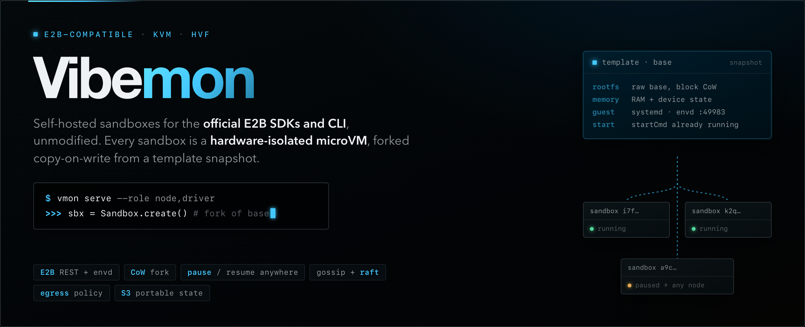
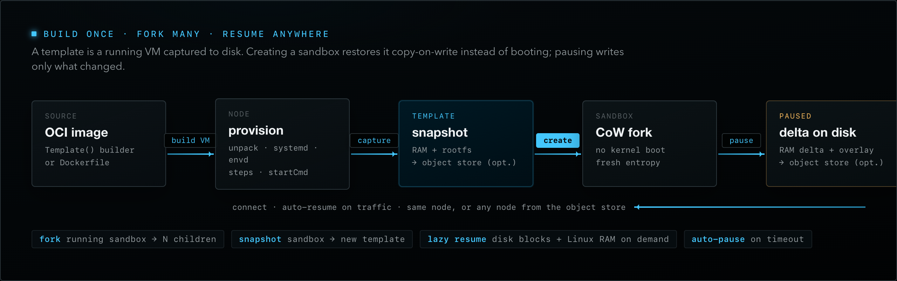
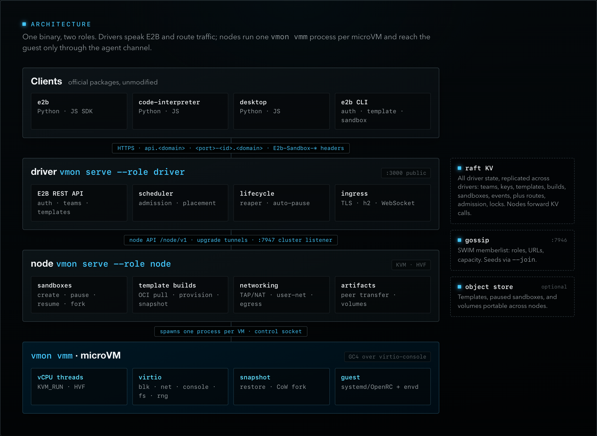

<p align="center">
  
</p>

# Vibemon

Vibemon (`vmon`) is a KVM/HVF microVM platform that speaks the E2B API. Point
the official E2B SDKs (`e2b`, `@e2b/code-interpreter` / `e2b_code_interpreter`,
`@e2b/desktop` / `e2b_desktop`) or the `e2b` CLI at it and they work
unmodified. Every sandbox is a hardware-isolated microVM, forked
copy-on-write from a template snapshot; it can pause to disk and resume on
any node.

**[Documentation](https://stencil-hq.github.io/vibemon/)** ·
[Quickstart](https://stencil-hq.github.io/vibemon/get-started/quickstart.html) ·
[E2B compatibility](docs/src/reference/e2b-compat.md) ·
[Architecture](ARCHITECTURE.md) ·
[Changelog](CHANGELOG.md)

## Quickstart

Monolithic server on macOS Apple Silicon, from a checkout:

```sh
just kernel --arch aarch64       # vmon guest kernel → target/kernel/ (Docker)
just serve                       # builds vmon + the guest agent, serves the API on 127.0.0.1:3000
just templates base              # builds `base` as a public system template (no E2B_API_KEY set)
"$(just bin)" admin create-team dev   # via the running driver; prints an e2b_… key
```

On Linux/KVM the node needs root or `CAP_NET_ADMIN` for TAP networking, so
`vmon serve` runs under `sudo` with an explicit cluster secret; the
[quickstart](https://stencil-hq.github.io/vibemon/get-started/quickstart.html)
covers both hosts and release binaries.

```python
# E2B_API_KEY=e2b_… E2B_DOMAIN=localhost E2B_API_URL=http://127.0.0.1:3000 \
# E2B_SANDBOX_URL=http://127.0.0.1:3000
from e2b import Sandbox

sbx = Sandbox.create()                              # forks the template snapshot
print(sbx.commands.run("uname -a").stdout)
sbx.files.write("/home/user/hello.txt", "hi")
sbx.pause(); sbx = Sandbox.connect(sbx.sandbox_id)  # snapshot to disk, then resume
sbx.kill()
```

`E2B_SANDBOX_URL` sends sandbox traffic to the API listener, which routes it
by the `E2b-Sandbox-*` headers. In production, run `--tls-listen` with a
wildcard certificate for `*.<domain>` and `api.<domain>`; the SDKs then use
`https://<port>-<sandboxId>.<domain>` directly and need only `E2B_DOMAIN`.

## How it works

<p align="center">
  
</p>

- **Templates** are built with the E2B v2 `Template` builder or `e2b template
  create` from a Dockerfile. A node pulls the OCI image, unpacks it inside a
  build VM, provisions it the way upstream E2B does (systemd/OpenRC, user
  `user` with sudo, envd as a service), runs the steps, and snapshots the VM
  with `startCmd` running.
- **Sandboxes** are copy-on-write forks of that snapshot: no kernel boot, fresh
  guest entropy per fork. `fork` clones a running sandbox; `snapshots` turns
  one into a new template.
- **Pause** writes the RAM delta against the template base and the disk
  overlay. With `--object-store s3://bucket/prefix` the state is uploaded in
  the background, and `connect` resumes it on any compatible node, fetching
  disk blocks (and, on Linux, guest memory) lazily.
- **Defaults**: `templates/` holds the templates the SDKs expect (`base`,
  `code-interpreter-v1`, `desktop`, `mcp-gateway`) for aarch64 and x86_64
  guests; `just templates` publishes them from a system team so the bare
  aliases resolve for every team.

## Architecture

<p align="center">
  
</p>

One Rust binary, three entry points:

| Command | What it does |
|---|---|
| `vmon serve --role node,driver` | Runs the **node** role (hosts microVMs, builds templates), the **driver** role (E2B REST API, sandbox ingress, scheduling), or both. |
| `vmon vmm …` | The per-VM monitor (KVM / Hypervisor.framework / WHP). Spawned by nodes, never by hand. |
| `vmon admin …` | Teams, users, API keys, limits, system teams (talks to a running driver's cluster listener). |

- **Monolithic**: one process with both roles.
- **Distributed**: any number of driver and node processes, discovered through
  a gossip memberlist (`--join`). Drivers form a raft KV that holds all
  state: live cluster state (sandbox routes, admission, locks) and the durable
  records (teams, keys, templates, builds, sandboxes, events, …). There is no
  external database.

## Highlights

- **E2B fidelity**: every operation in the upstream OpenAPI spec is routed,
  envd is reimplemented in the guest agent, and the upstream Python and JS SDK
  suites run unmodified against `vmon serve` ([`e2e/`](e2e/README.md)).
- **Ingress**: `<port>-<id>.<domain>` or `E2b-Sandbox-*` headers, TLS with h2,
  WebSocket passthrough, traffic tokens, auto-resume on traffic, through any
  driver.
- **Egress policy**: `allowInternetAccess`, `allowOut`/`denyOut` CIDRs and
  domains; on Linux also HTTPS header rules and SOCKS5 upstreams, changeable
  live.
- **Portable state** (optional object store): templates, paused sandboxes, and
  E2B volumes live in S3-compatible storage; `vmonS3Mounts` mounts your own
  buckets read-only, overlay, or write-back. Credentials stay on the host.
- **Admin dashboard**: every driver serves `/dashboard/` behind the admin
  token: fleet charts, every team's sandboxes with a terminal and file
  browser, node draining ([Administration](https://stencil-hq.github.io/vibemon/operate/admin.html#admin-dashboard)).
- **Failover**: raft leader loss, node loss, and graceful node restarts are
  covered by a gated distributed test ([`just cluster-e2e`](docs/src/develop/cluster-verification.md)).

## Platforms

| | Linux / KVM | macOS 15+ / HVF | Windows / WHP |
|---|---|---|---|
| Guest arch | x86_64, aarch64 | aarch64 | x86_64 |
| `vmon vmm` | ✅ | ✅ | ✅ |
| node role | ✅ TAP + NAT, transparent egress proxy (domains, SOCKS5, HTTPS header rules) | ✅ user-mode NAT, in-VMM egress filter (CIDRs, DNS-learned domains) | — |
| driver role | ✅ | ✅ | — |

macOS binaries must be ad-hoc signed with `hvf.entitlements` (`just build` does it).
On Linux the node needs `/dev/kvm`, and TAP networking needs root or `CAP_NET_ADMIN`.

The guest kernel is the vmon kernel ([`kernel/`](kernel/README.md), `just
kernel`). It ships next to `vmon` in release assets and is found under
`target/kernel/` in a dev tree. It has the netfilter, IPv6, cgroup v2, overlay
and NFS features that templates and Docker-in-sandbox rely on.

## Development

```sh
just build | just lint | just test     # workspace build, clippy -D warnings, unit tests
just agent-musl                        # static guest agent → target/test-assets/
just integration                       # VMM integration tests (VMON_E2E=1)
just cluster-e2e                       # 3 drivers + 2 nodes failover test
just e2e all                           # upstream E2B Python + JS SDK suites (see e2e/README.md)
mdbook serve docs --port 3100          # documentation site on http://localhost:3100
```

| Path | Crate | Purpose |
|---|---|---|
| `vmm/` | `vmm` | The VMM: KVM/HVF/WHP, virtio devices, snapshot/restore/fork. |
| `agent/` | `vmon-agent` | Guest agent: GC4 control channel, tunnels, OCI unpack, and an envd reimplementation. |
| `cluster/` | `vmon-cluster` | Gossip memberlist, raft KV (openraft), `Cluster` facade. |
| `node/` | `vmon-node` | VM runtime, sandboxes, template builds, artifacts, egress, node API. |
| `driver/` | `vmon-driver` | E2B API, KV store, auth, scheduler, lifecycle, ingress. |
| `cloud/` | `vmon-cloud` | Cloud workload identity, request signing, and the S3 client (object store, bucket mounts). |
| `src/` | `vmon` | The binary: `serve`, `admin`, `vmm` dispatch. |
| `docs/` | — | The documentation site (mdBook). |

The README graphics are rendered from [`assets/graphics.src.html`](assets/graphics.src.html).

## License

MIT (see [`LICENSE`](LICENSE)). E2B-derived specs, templates and provisioning
scripts keep their Apache-2.0 license; see `spec/e2b/SOURCES.md`,
`templates/SOURCES.md` and [`THIRD-PARTY-NOTICES.txt`](THIRD-PARTY-NOTICES.txt).
